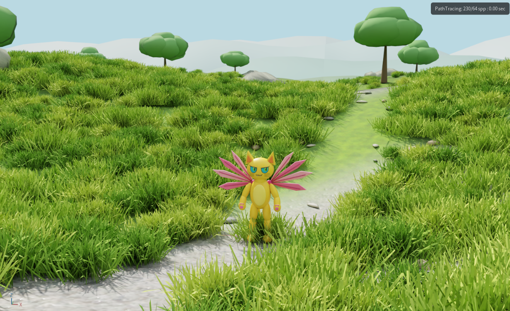
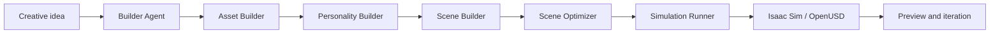
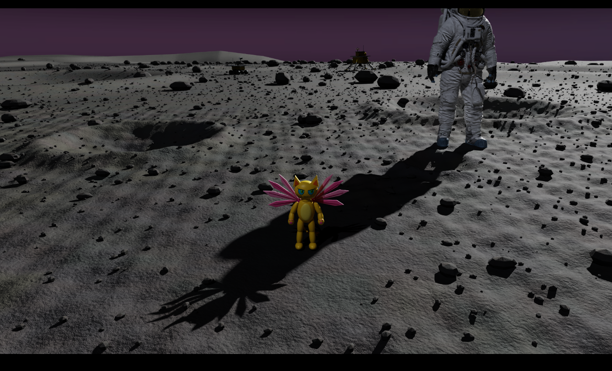

# Unbound Maker

[English](README.md) | [简体中文](README.zh-CN.md)

**Help every child create a robot companion.**

Unbound Maker connects young people's character ideas with interactive worlds
and physics experiments on NVIDIA DGX Spark. FlyingCat, our first case, starts
with an idea: a mischievous winged cat that wants to visit the Moon.

[Watch the English demo](https://www.youtube.com/watch?v=8etBpM4SxAM) |
[Watch the Chinese demo](https://www.bilibili.com/video/BV1DoaW6PEMK/)

## From an Idea to a Simulated World

A Builder Agent coordinates five Skills: building a character, shaping its
expressions, composing a scene, optimizing it, and running a simulation.
Creators can change supported character and experiment settings, see the
result, and iterate.

| Skill | Role |
| --- | --- |
| Asset Builder | Configure a character from an existing template. |
| Personality Builder | Add expressions and head movements. |
| Scene Builder | Place the character in meadow, space, or Moon scenes. |
| Scene Optimizer | Organize scene detail and reusable OpenUSD composition. |
| Simulation Runner | Run the scene and produce previews and experiment results. |

## Stories and Experiments

**Story mode:** explore a meadow or a space scene with the character.

**Experiment mode:** compare motion under Earth, Moon, and zero gravity,
changing mass and upward force to observe the differences. Flight currently
uses applied force; leg movement uses animation.

## Technology

- NVIDIA DGX Spark: local model inference, building, and simulation.
- NVIDIA Isaac Sim / PhysX: rendering, collisions, gravity, and force-based motion.
- OpenUSD: character and scene composition, instances, payloads, and level of detail.
- Python and local Qwen models: the Builder Agent and Skill execution workflow.

The demonstrated workflow connects a web request to the five Skills, an Isaac
Sim run, and returned previews and reports. Parameter changes can trigger a
new simulation while reusing unaffected build stages.

## Selected Code

[JSON contract helpers](examples/README.md) provide a small, dependency-free
example extracted from the Builder's input-handling code: strict JSON parsing,
canonical serialization, and field and value validation.

## Community

Developed by [Unbound Maker Community](https://github.com/unboundmakers),
bringing women, young people, and cross-disciplinary creators together around
AI, smart hardware, robotics, design, and education.

## Credits and License

Code: [Apache-2.0](LICENSE). Documentation: [CC BY 4.0](LICENSES/CC-BY-4.0.txt).
Character and demonstration images retain their separate rights.
See [license scope](LICENSING.md) and [third-party credits](THIRD_PARTY_NOTICES.md).
