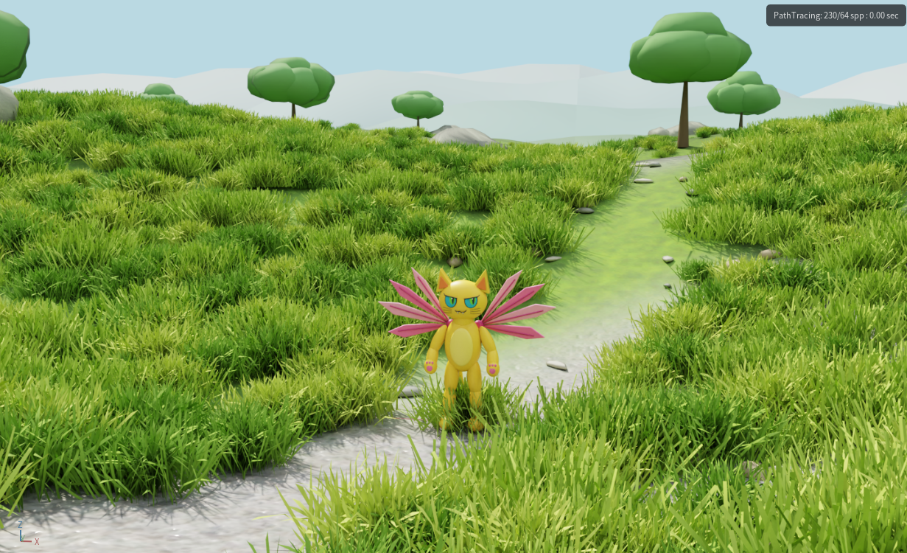
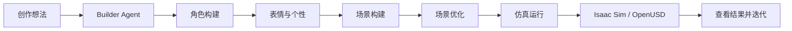
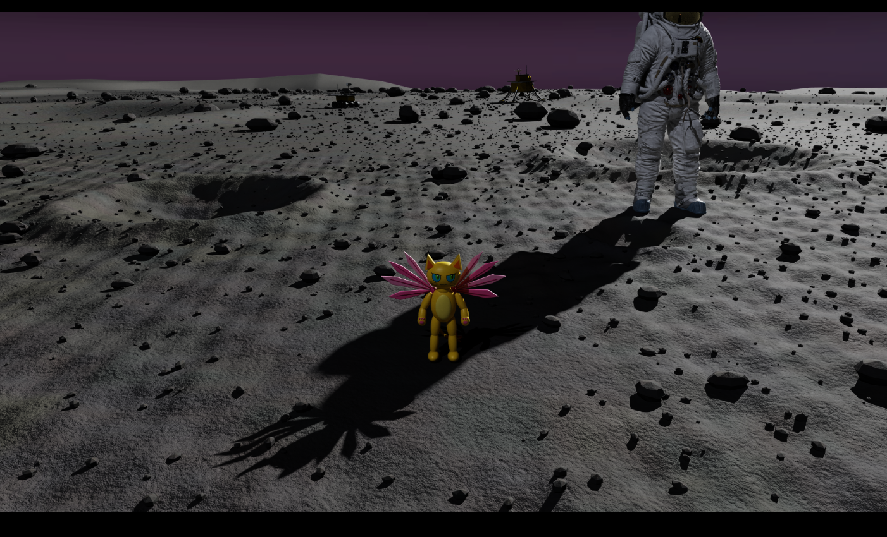

# AI 造物 · 青少年机器人创作平台

[English](README.md) | [简体中文](README.zh-CN.md)

**让每个孩子，都能造出自己的机器人伙伴。**

Unbound Maker 把孩子的角色想法，连接到 NVIDIA DGX Spark 上的互动世界与物理实验。
第一个案例是飞行喵：一只有翅膀、有点调皮，还想去月球看看的猫。

[观看中文演示](https://www.bilibili.com/video/BV1DoaW6PEMK/) |
[观看英文演示](https://www.youtube.com/watch?v=8etBpM4SxAM)

## 从想法到仿真世界

一个 Builder Agent 组织五个 Skill，依次处理角色、表情、场景、优化和仿真。
创作者可以修改受支持的角色与实验参数，看到结果，再继续调整作品。

| Skill | 负责什么 |
| --- | --- |
| Asset Builder | 从已有模板配置角色。 |
| Personality Builder | 加入表情和头部动作。 |
| Scene Builder | 把角色放进草地、太空或月球场景。 |
| Scene Optimizer | 组织场景细节与可复用的 OpenUSD 场景结构。 |
| Simulation Runner | 运行场景，生成预览与实验结果。 |

## 故事与实验

**故事模式：** 带着角色在草地或太空场景中活动。

**实验模式：** 比较地球、月球和无重力条件下的运动，改变质量与向上作用力，
观察结果有什么不同。当前飞行使用外力驱动，腿部动作使用动画。

## 技术组成

- NVIDIA DGX Spark：本地模型推理、构建与仿真。
- NVIDIA Isaac Sim / PhysX：渲染、碰撞、重力与外力驱动的运动。
- OpenUSD：角色与场景组合、实例化、payload 与细节层级。
- Python 与本地 Qwen 模型：Builder Agent 和 Skill 执行流程。

演示链路已连接网页需求、五个 Skill、Isaac Sim 运行，以及预览和报告返回。
修改参数后，可以复用未受影响的构建阶段，再运行新的仿真。

## 精选代码

[JSON 校验工具](examples/README.md)从现有 Builder 的输入处理代码中提取，
展示严格 JSON 解析、规范化序列化、字段与数值校验，不依赖额外软件包。

## 社区

项目由 [AI 造物社区](https://github.com/unboundmakers)推进，连接女性、青少年与
跨学科创作者，一起探索 AI、智能硬件、机器人、设计与教育。

## 署名与许可

代码采用 [Apache-2.0](LICENSE)，文档采用 [CC BY 4.0](LICENSES/CC-BY-4.0.txt)。
角色与演示图像保留各自权利。详见[授权范围](LICENSING.md)与
[第三方来源](THIRD_PARTY_NOTICES.md)。
